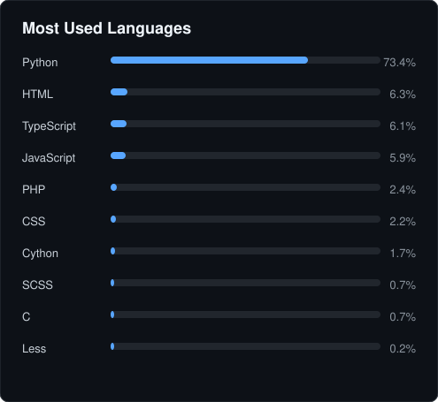

  

<h3 align="center">Software Engineer · Backend & AI · I build the systems behind the screen</h3>

  
  
  
  

---

### `$ whoami`

- Software Engineer at **Kayan Health Tech**: I build and run a FHIR R4 claims switch that moves insurance claims between providers and payers, plus national e-claims integrations.
- Freelance Full Stack Engineer at **Coderz**, a SaaS for Salla merchants.
- I explain how tech works on LinkedIn, Instagram and YouTube, because understanding how things work makes life better.
- Computer Systems Engineering at Al-Azhar University – Gaza.

### `$ ls ~/stack`

  

**Also:** HL7 FHIR R4 · E-Claims · REST & GraphQL · WebSockets · LLMs · RAG · OCR · AI Agents

### `$ ls ~/projects --featured`

| Project | What it is | Stack |
|---|---|---|
| [e-commerce-api](https://github.com/z4dev/e-commerce-api) | E-commerce REST API | Node.js · Express |
| [NestJS-TypeORM](https://github.com/z4dev/NestJS-TypeORM) | NestJS service with TypeORM and MySQL | NestJS · TypeORM |
| [MERN-WithGraphQL--chat-app-](https://github.com/z4dev/MERN-WithGraphQL--chat-app-) | Real-time chat app with a GraphQL API | React · Apollo · GraphQL |
| [url-shortner-service](https://github.com/z4dev/url-shortner-service) | URL shortener service | Node.js |
| [img-converter](https://github.com/z4dev/img-converter) | AI image converter into many shapes | TypeScript · AI |
| [senior-backend-engineer](https://github.com/z4dev/senior-backend-engineer) | 18–24 month roadmap from junior to senior backend | Roadmap |

### `$ git log --stats`

  
  

Izzedeen Alfarra | z4dev

